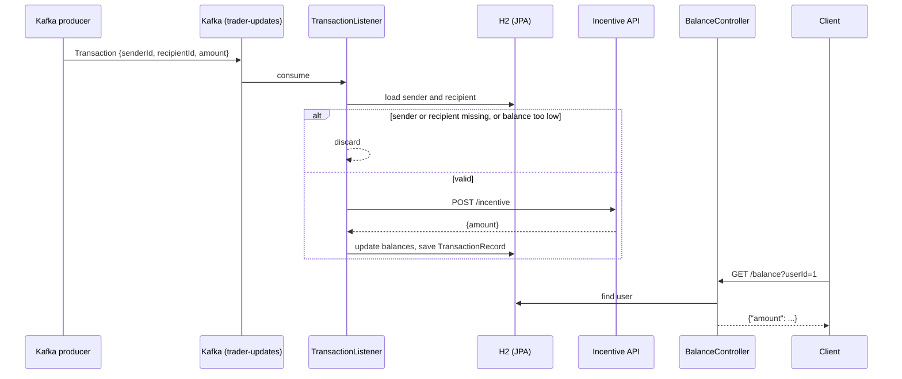

<div align="center">

# Midas Core

**A Kafka-driven transaction-processing microservice built with Spring Boot.**

Consumes transactions from Kafka, validates them, updates user balances in a database,
calls an external incentive API and exposes balances over REST.


</div>

> Built during the [JPMorgan Chase Software Engineering Job Simulation](https://www.theforage.com/simulations/jpmorgan/software-engineering-5wud)
> on Forage. The project skeleton, task verifier tests and the incentive API jar were provided; the business logic was
> implemented by me. This is a learning project, not JPMorgan Chase production code.

---

## What it does

Midas Core is the backend of a simulated money-transfer platform. Transactions arrive on a Kafka topic; each one is
checked, applied to the sender's and recipient's balances, enriched with an incentive from a separate REST service,
and recorded. Current balances can be queried over HTTP.

## Features

- **Kafka consumer**: `TransactionListener` listens on the `trader-updates` topic and receives each message as a `Transaction` (sender ID, recipient ID, amount).
- **Validation**: a transaction is applied only if the sender exists, the recipient exists, and the sender's balance covers the amount. Anything else is discarded.
- **Transactional balance updates**: debiting the sender, crediting the recipient and saving the record happen in one `@Transactional` method using Spring Data JPA.
- **Incentive API integration**: `IncentiveClient` POSTs each valid transaction to the incentive service with `RestTemplate`; the returned amount is added to the recipient's balance.
- **Transaction history**: every applied transaction is stored as a `TransactionRecord` (sender, recipient, amount, incentive) in H2.
- **Balance REST endpoint**: `GET /balance?userId=<id>` on port `33400` returns the user's current balance as JSON.

## Architecture



## Tech stack

| Area | Technology |
|---|---|
| Language | Java 17 |
| Framework | Spring Boot 3.2.5 (Web, Data JPA) |
| Messaging | Apache Kafka via Spring for Apache Kafka 3.1.4 |
| Database | H2 in-memory (`jdbc:h2:mem:midascore`) |
| HTTP client | Spring `RestTemplate` |
| Testing | Spring Boot Test, `@EmbeddedKafka` (spring-kafka-test) |
| Build | Maven (wrapper included) |

## API

| Method | Path | Query params | Response |
|---|---|---|---|
| `GET` | `/balance` | `userId` (long, required) | `{"amount": <float>}`. Unknown users return `{"amount": 0.0}`. |

Example:

```bash
curl "http://localhost:33400/balance?userId=1"
```

## Project structure

```
midas-core/
├── src/main/java/com/jpmc/midascore/
│   ├── component/    # TransactionListener, IncentiveClient, BalanceController, DatabaseConduit
│   ├── entity/       # JPA entities: UserRecord, TransactionRecord
│   ├── foundation/   # DTOs: Transaction, Incentive, Balance
│   ├── repository/   # Spring Data repositories
│   └── MidasCoreApplication.java
├── src/main/resources/application.yml   # Kafka topic, H2 datasource, port 33400
├── src/test/java/com/jpmc/midascore/    # Forage task verifiers + test helpers
├── src/test/resources/test_data/        # Seed users and transaction files
└── services/transaction-incentive-api.jar
```

## Getting started

### Prerequisites

- JDK 17
- No Maven install needed: use the included `./mvnw` wrapper (or `mvnw.cmd` on Windows)

### 1. Start the incentive API

The provided jar listens on port `33433` by default, while `IncentiveClient` calls `http://localhost:8080/incentive`,
so start it on port 8080:

```bash
java -jar services/transaction-incentive-api.jar --server.port=8080
```

### 2. Run the end-to-end test

In a second terminal, from the project root:

```bash
./mvnw test -Dtest=TaskFiveTests
```

This starts an embedded Kafka broker on `localhost:9092`, boots the app on port 33400, seeds users from
`src/test/resources/test_data/`, publishes a batch of transactions to Kafka, waits for them to be processed and then
logs each user's balance as returned by `GET /balance`.

> `TaskTwoTests`, `TaskThreeTests` and `TaskFourTests` are Forage debugger exercises that loop forever on purpose,
> so a plain `./mvnw test` will not finish. Run tests by name with `-Dtest=...`.

### Running the service on its own

```bash
./mvnw spring-boot:run
```

The app starts on port 33400 and connects to a Kafka broker at Spring Boot's default `localhost:9092`, so a broker must
already be running there. The H2 database is in-memory and starts empty, so `/balance` returns `0.0` until users are added.

## What I learned

- Consuming Kafka messages with `@KafkaListener` and testing them with an embedded broker.
- Modelling entities and relationships with Spring Data JPA and keeping related updates in one transaction.
- Calling another service over REST and folding its response into the processing pipeline.
- Exposing data through a small Spring Web REST controller.

## Roadmap

- Move the incentive API URL into `application.yml` instead of a hard-coded constant.
- Add Kafka consumer and broker settings to the main config so the service runs end to end outside the tests.
- Use `BigDecimal` instead of `float` for money.
- Replace log-based verifiers with assertion-based integration tests.

## Author

**Rahul Singh**

[](https://github.com/Rahul-web01)
[](https://www.linkedin.com/in/rahul-singh-cs)

---

<div align="center">

If you found this useful, consider giving it a ⭐

</div>
